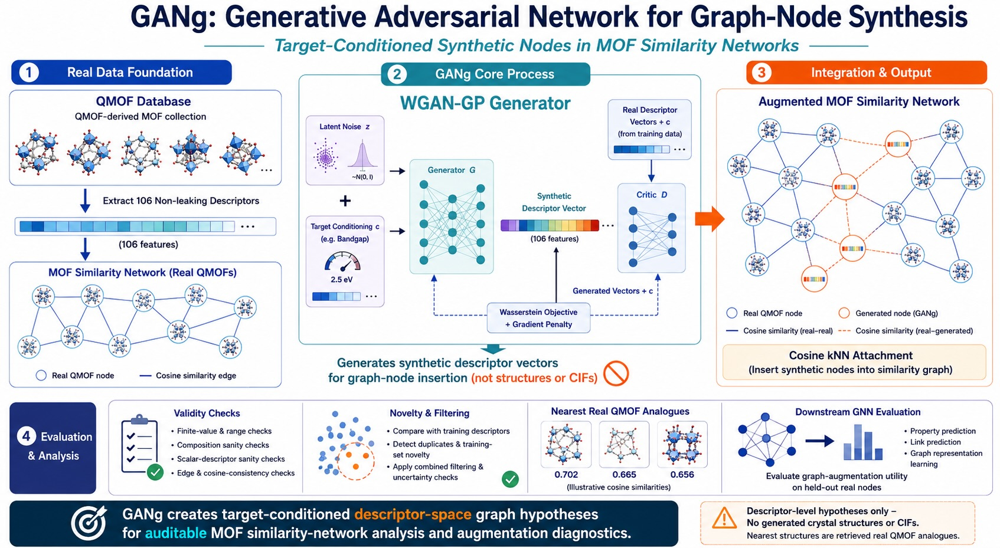

# GANg

**Generative Adversarial Network for Graph-Node Synthesis in MOF similarity networks**

<p align="center">
  
</p>

GANg is a target-conditioned framework for generating and evaluating synthetic **descriptor-space graph nodes** in metal-organic framework (MOF) similarity networks. In this repository, a QMOF-derived dataset is represented as a graph: each real QMOF entry is a node, edges encode descriptor-space similarity, and GANg-generated nodes are inserted as synthetic descriptor-vector hypotheses.

The repository is intended for reproducible study of:

- descriptor-space generation;
- graph insertion by cosine nearest neighbours;
- descriptor, edge, non-duplication, and training-set novelty screens;
- nearest-real-QMOF analogue retrieval for interpretation;
- downstream GNN augmentation diagnostics;
- validation-selected mode selection and implementation-grounded consistency checks.

## Claim boundary

GANg outputs are descriptor-space graph hypotheses. They are **not** generated CIFs, predicted crystal structures, DFT-validated materials, force-field-relaxed structures, synthesis-ready candidates, or experimentally validated MOFs. Nearest QMOF structures, when reported, are retrieved real analogues used for interpretation only.

The current evidence supports an auditable graph-node generation and evaluation workflow. It should not be read as proof of physical inverse design or as evidence that GANg has broader descriptor-space coverage than simpler statistical generators.

## Repository layout

```text
configs/       Configuration files for the QMOF-derived workflows
experiments/   Locked experiment outputs and source tables
scripts/       Build, audit, figure, and consistency-check scripts
tables/        Public summary/evidence tables used by audits and figures
archive/       Historical proof-of-concept package
```

Manuscript source files and internal reports are intentionally not included in this public code snapshot.

## Quick validation

Run the implementation-grounded consistency check:

```bash
python3 scripts/42_final_consistency_assertions.py
```

Expected result:

```text
PASS final implementation-grounded consistency assertions
```

This check recomputes consistency relationships from public evidence tables and locked experiment outputs rather than relying on manually typed expected manuscript values.

## Key reproducibility scripts

Core 1000-node package:

```bash
python3 scripts/09_build_final_package.py --config configs/qmof_galaxy_1000.yaml
python3 scripts/10_finalize_gang_package.py
python3 scripts/11_gang_audit_pass.py
python3 scripts/12_submission_polish.py
```

Validation-selected downstream audit:

```bash
python3 scripts/46_validation_selected_downstream_audit.py
```

Implementation-grounded graph-scaling audit:

```bash
python3 scripts/47_implementation_grounded_audit.py
```

Final consistency check:

```bash
python3 scripts/42_final_consistency_assertions.py
```

Figure/table regeneration scripts:

```bash
python3 scripts/29_make_generative_upgrade_figures.py
python3 scripts/37_journal_style_polish_figures.py
```

## Important evidence tables

- `tables/validation_selected_results.csv`
- `tables/validation_selected_seedwise_results.csv`
- `tables/validation_selected_statistics.csv`
- `tables/implementation_grounded_scaling_summary.csv`
- `tables/implementation_grounded_metric_source_map.csv`
- `tables/implementation_grounded_consistency_checks.csv`
- `tables/remaining_issues/generator_baseline_validity_with_gang.csv`

The 5000-node target-specific downstream source tables are under:

- `experiments/qmof_gang_5000_outputs_pbe_bandgap/tables/`
- `experiments/qmof_gang_5000_outputs_pbe_cbm/tables/`
- `experiments/qmof_gang_5000_outputs_pbe_vbm/tables/`
- `experiments/qmof_gang_5000_outputs_pbe_energy_total/tables/`

## Environment

Python 3.10+ is recommended. Common dependencies include:

- `numpy`
- `pandas`
- `scipy`
- `scikit-learn`
- `matplotlib`
- `seaborn`
- `networkx`
- `torch`
- `pyyaml`

For headless systems:

```bash
export MPLBACKEND=Agg
```

## Raw data

The workflow is based on QMOF-derived descriptors and metadata. If rebuilding from raw inputs, obtain the QMOF data from the original QMOF source and place the required raw files under `data/raw/` following the configuration files.

The public repository also includes locked derived source tables for the reported audits, so the final consistency check can be run without regenerating every training run from scratch.

## Citation

If you use this repository, please cite the project repository:

```text
Mehrdad Jalali, GANg: Generative Adversarial Network for Graph-Node Synthesis in MOF similarity networks,
https://github.com/MehrdadJalali-AI/GANg
```
